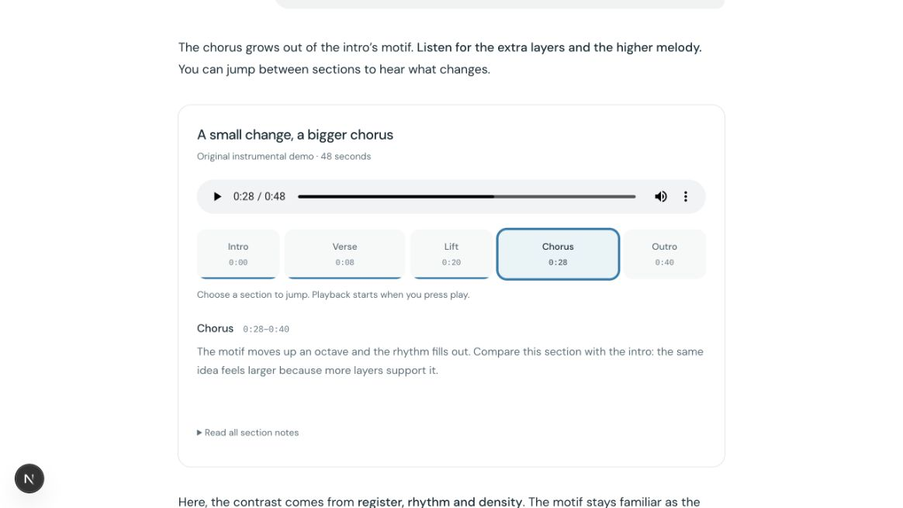

# Intelligent UI final review — October 18, 2026

Historical checkpoint; superseded by the [October 19 final validation](REVIEW-2026-10-19.md).

**Merge recommendation: HOLD.** Complete a permitted native-media smoke check of
last seekability changes, then settle the remaining structural review dispositions.
No merge or deployment was invoked. No production write, paid action or client
import was performed.

## Source and scope

Existing app [PR #2243](https://github.com/recoupable/app/pull/2243), epic #2197.
Baseline `97dacb222a214c050968e1fd80690f5f9ccdbb14` had not advanced at task start.
Runtime verification commit: `133b14470fd9e351934f9b822693a3c656d21320`, including
transient range retries. This later documentation update does not change runtime code. Current remote checks/state belong on the owning PR.
The product remains an authored fixture lab, production-gated/404, not live chat.
Context assessment provenance/save changes remain with their owning implementation.

## Findings and dispositions

Read all 48 baseline unresolved threads across 101 paginated threads, including
10 marked outdated: 19 addressed, 13 already addressed/superseded, 16 not adopted.
Subsequent runtime and documentation review is recorded separately in the ledger.
[Thread-by-thread dispositions and reasons](REVIEW-THREADS-2026-10-18.md).
Eighteen structural suggestions remain open for reviewer agreement; these are
review workflow state, not established functional-bug counts. Maintained repository
instructions require focused responsibilities and do not set a universal 100-line cap.

Fixed link-title loss, native-error exposure, final-event cancellation, source
focus/return, theme hydration/readiness, deterministic reporting dates and a media
initialization race that erased restoration. Integration checks now cover every
PR/main push. Legacy protocol fixtures have separate owning modules.
Final follow-up retains pending selection across transient range gaps and retries
on metadata, canplay and progress. The player stays mounted but hidden until its
target is seekable; useful notes remain visible. A canplay gap is not permanent
failure. The legacy supplier fallback no longer names a nonexistent source.
The [HTML media seeking contract](https://html.spec.whatwg.org/multipage/media.html#seeking)
permits seeking to return without a seek when no ranges exist; readiness and
seekability are therefore checked separately. This does not prove browser behavior.

## Validation

191 focused tests across 24 files, full TypeScript, scoped ESLint, Prettier/diff
checks and production build pass for the final runtime source. Added tests cover
canplay before ranges, later progress recovery, and ready-but-unseekable media. Production page, stream
and media denial plus provider/cache isolation remain tested. Existing dependency
and deprecation warnings remain. No further runtime changes accompany this handoff.

## Permitted browser evidence

[Ten screenshots, gallery and hash manifest](review-evidence/2026-10-18/README.md)
are committed for reviewer access. Captured runtime: `cae767d6e`, before the final
seekability guard. Actor/scope: developer inspecting local synthetic fixtures in
the in-app Chromium browser; no customer session or production-write authority.

- Desktop and measured 390px/320px CSS layouts: Markdown and chart caused no page overflow.
- Native picker/section keyboard use, source-heading focus and Escape return verified.
- Native 48-second WAV decoded; paused 0s→28s selection did not play. Return restored
  40.155829s paused; reload restored 28s after metadata. Native scrubbing across
  40s changed Outro to Chorus. Actual playback and selection while playing operated.
- A temporary missing-media URL preserved restored Chorus and notes; its HTTP
  status was not captured. Original resolver was restored exactly, with no final diff.
- Light/dark states were inspected. Date/theme hydration errors were reproduced,
  repaired and absent on subsequent permitted checks. Media sound quality was not heard.

## Exact remaining limitation and next step

After restarting the dev server, a final reload targeted a generated `data:text/html`
connection-refused page, which Browser Use URL policy blocked. No alternate browser,
raw page fetch or security workaround was attempted. Prior evidence is retained;
final range-readiness changes and post-restart UI readback lack native-browser proof.

Next owner: Intelligent UI maintainer, with Recoup OS reading this handoff directly.
On the final head, verify the original WAV loads/has seekable ranges, paused section
selection/restoration seeks without autoplay, delayed ranges retain pending selection,
and unsupported media retains useful notes. Then agree on the 18 structural
suggestions and check required CI before a separate explicit merge approval.

Physical mobile/Safari, native screen readers, audible quality, 200% zoom, optional
participant research, live chat/model composition, authenticated adapters, actions,
a second host and an SDK release remain unverified/outside this slice. Optional
participant research is not a release blocker. Shared coordinator files were preserved.
