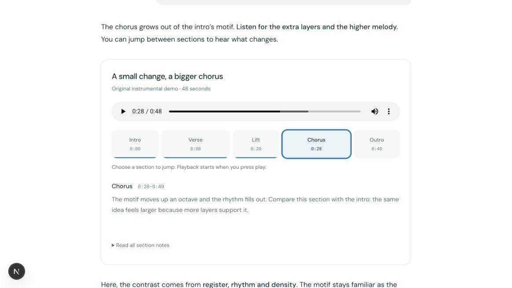
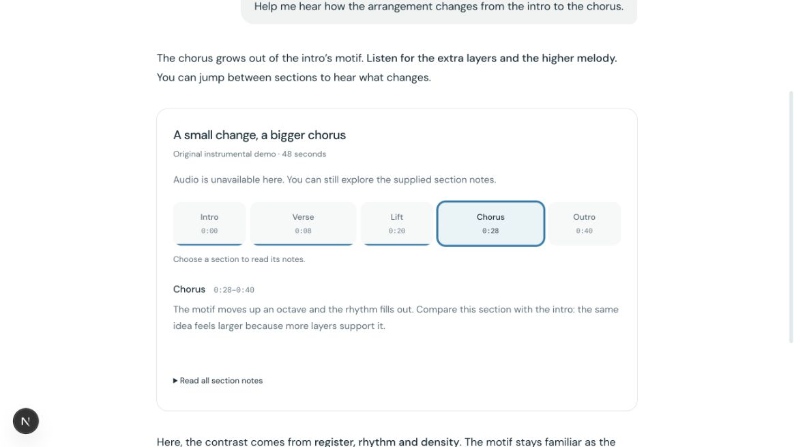
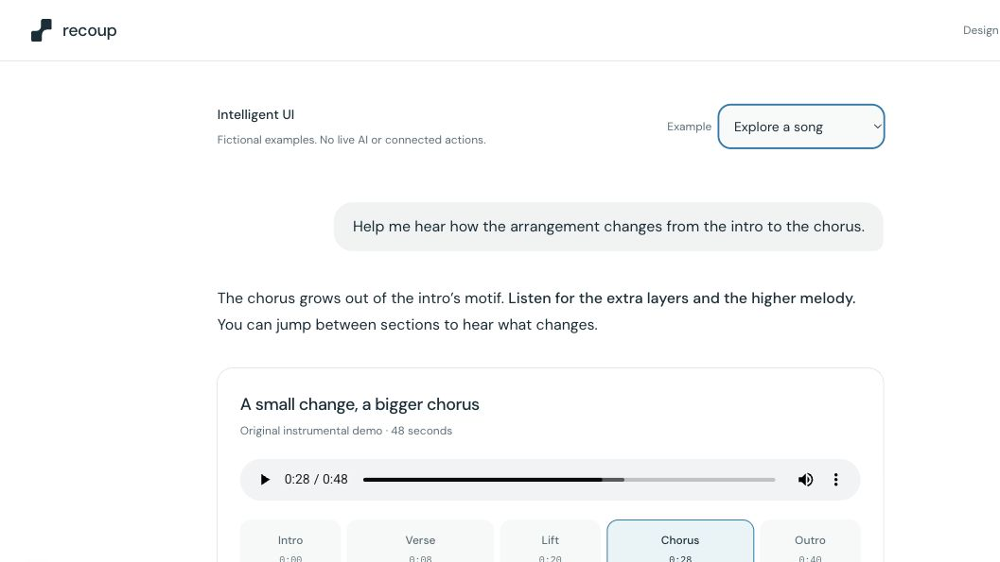

# Native audio validation — October 19, 2026

Historical captures before the duration-boundary fix. See the
[latest validation and gate](../2026-10-19-final/README.md).

Source: `b3c277c4fc453ce3836ba47b27fc6d5a0a521edc`; runtime unchanged from
`133b14470fd9e351934f9b822693a3c656d21320`. Synthetic local fixtures, in-app Chromium.
[Detailed handoff](../../REVIEW-2026-10-19.md), [observations](observations.json),
[hash manifest](manifest.json). These are developer observations, not measured user benefit.

## Paused selection on the exact source

## Native failure with useful notes

Temporary missing-asset resolver binding; component code unchanged. The resolver was
subsequently restored exactly. HTTP status was not captured.

## Original media after restoration

Native state: 28s, duration 48s, paused, readyState 4, seekable [0,48], no media error.
Forced event ordering remains deterministic-test coverage; natural readiness recovery
was observed. No physical-device, native-screen-reader or audible-quality claim.

